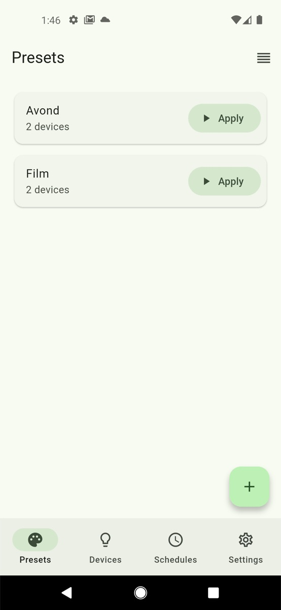
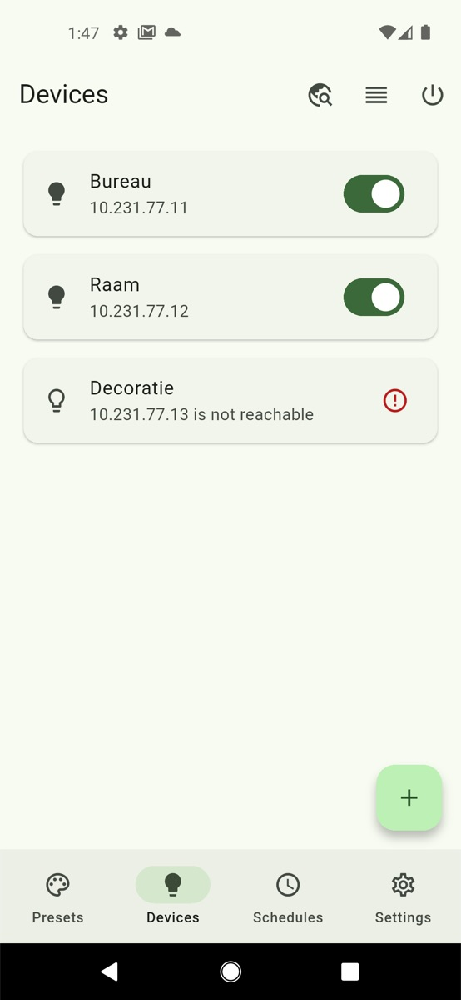
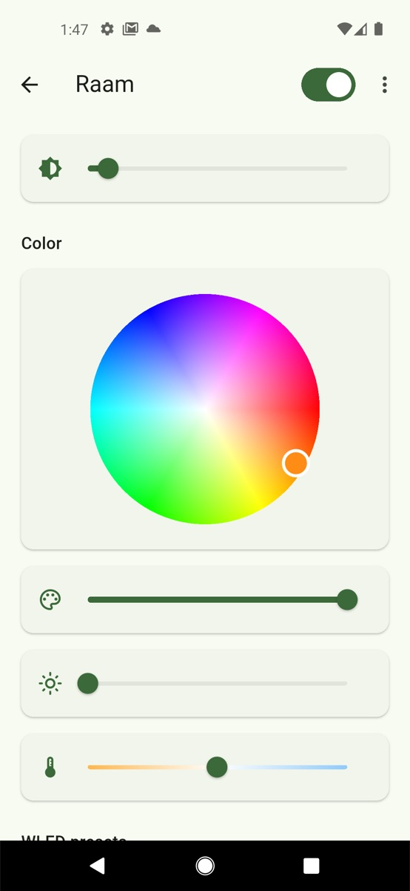
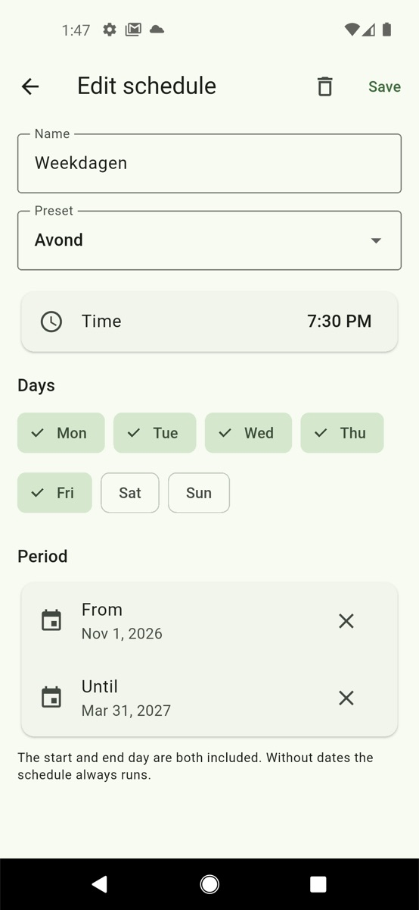
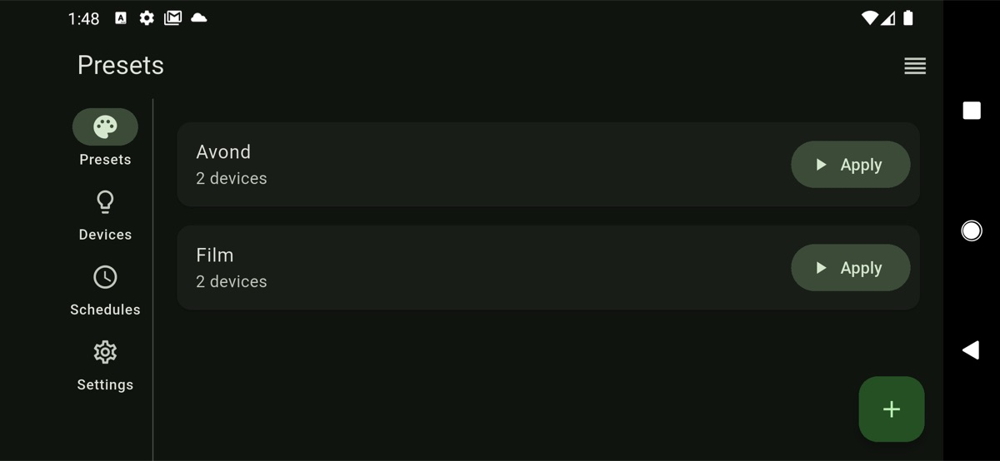

# WLED Dashboard

Control several [WLED](https://kno.wled.ge) light controllers from one place: turn them on and off, set color and
brightness, save **presets** that put a group of devices in a given state with one tap, and **schedule** presets.

One Docker image runs a Node backend that talks to the devices on the LAN, keeps devices, presets and schedules in
SQLite, runs the schedules, and serves the Flutter web app. The Android app talks to the same backend.

| Presets | Devices | Device | Schedule |
|---|---|---|---|
|  |  |  |  |



## Running it

```sh
docker run -d --network host -v wled-data:/data -e API_KEYS=change-me ghcr.io/renautmestdagh/wled:latest
```

Open `http://<host>:3000` and enter the API key under Settings. In the Android app also enter the server address; a
release build only connects over HTTPS.

| Variable | Default | |
|---|---|---|
| `API_KEYS` / `API_KEYS_FILE` | — | Comma-separated keys, or a file holding them (Docker secrets). Required. |
| `PORT` | `3000` | |
| `DB_PATH` | `/data/database.db` | Upgraded in place on start. |
| `TRUST_PROXY` | `loopback, linklocal, uniquelocal` | Proxies allowed to set `X-Forwarded-For` (rate limiting). |
| `TZ` | `Europe/Brussels` | Schedules run in this time zone. |

**Host networking is needed for "Find devices"**: discovery sends an mDNS query to the LAN, and multicast does not
cross Docker's bridge network. Devices can always be added by IP address.

Every `/api` request needs the key in an `X-API-Key` header. Requests without a valid key are rate limited.
`GET /health` needs no key.

## Development

The Flutter version is in `frontend/.fvmrc`; the Docker build and CI read it from there. The backend needs Node 26 and
runs its TypeScript directly, without a build step.

```sh
cd backend
npm ci
npm test               # node --test, against an in-memory database and a fake WLED device
npm run check          # prettier --check and tsc
node --env-file=.env src/server.ts   # see .env.example; or `npm run dev` with Infisical

cd frontend
flutter test
flutter analyze
flutter run            # a debug build may also use http://, e.g. http://10.0.2.2:3000 from the emulator
```

The web app is served by the backend at the same origin, so run `flutter build web` and copy `build/web` to
`backend/public` to try it locally.

## Releasing

`backend/package.json` and `frontend/pubspec.yaml` carry the version. Bump both, push to `master`, and publish a GitHub
release `vX.Y.Z`: CI runs the tests, checks that both versions match the tag, pushes the image as `X.Y.Z`, `X.Y` and
`latest`, triggers the deploy webhook and attaches `wled-dashboard.apk` to the release.
